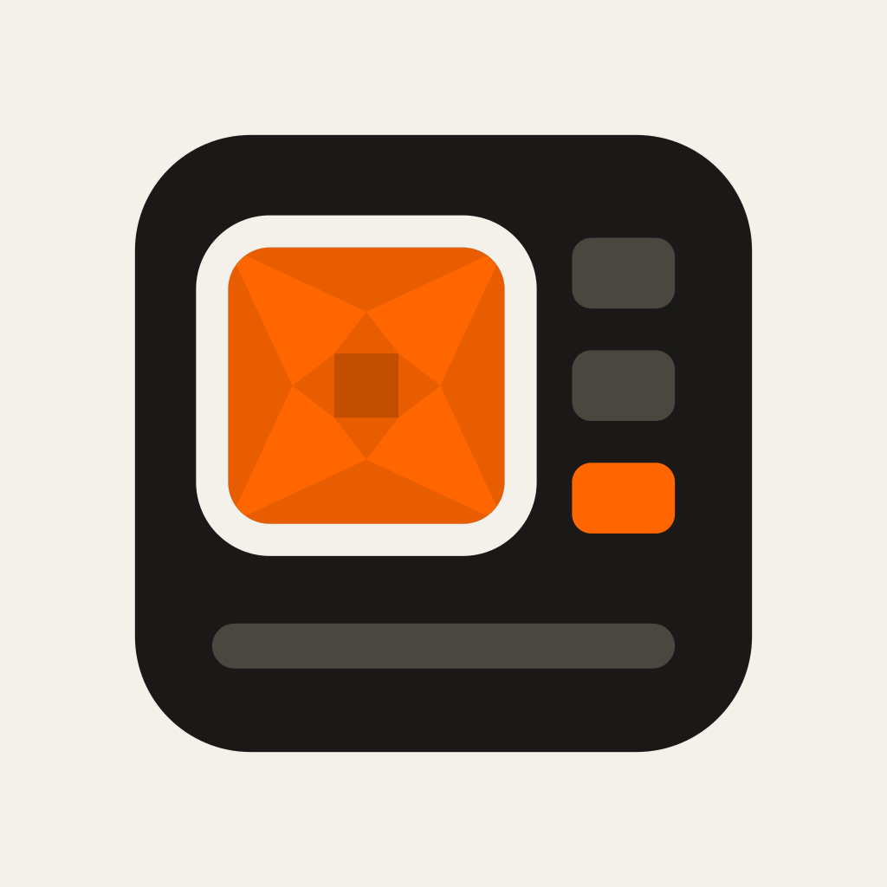

<p align="center">
  
</p>

<p align="center">
  
</p>

<h1 align="center">Monokulo Till</h1>

<p align="center">
  <strong>Take Monero at your till, in the point of sale you already use.</strong><br>
  The companion app to <a href="https://github.com/OceanEilonwy/monokulo">Monokulo</a>, for Square and Clover.<br>
  One Rust core, drawn natively: SwiftUI on iPhone and iPad, Compose on Android.
</p>

<p align="center">
  <a href="https://github.com/OceanEilonwy/monokulo-till/actions/workflows/rust.yml"></a>
  <a href="https://github.com/OceanEilonwy/monokulo-till/actions/workflows/android.yml"></a>
  <a href="https://github.com/OceanEilonwy/monokulo-till/actions/workflows/ios.yml"></a>
  <a href="LICENSE"></a>
</p>

<p align="center">
  <a href="#android"><b>Android</b></a> ·
  <a href="#iphone-and-ipad"><b>iPhone and iPad</b></a> ·
  <a href="#build-from-source"><b>Build from source</b></a> ·
  <a href="docs/design.md"><b>Design</b></a>
</p>

## Why Till

- **No new checkout.** The cashier rings up the sale in Square or Clover as usual and picks Monero as the
  payment. Till sees the sale and shows the customer its payment code.
- **Always in view.** The code and the payment's progress are in the Dynamic Island on iPhone, Slide Over on iPad,
  and a floating bubble and Live Update notification on Android.
- **Self-hosted.** Till connects to a store's own Monokulo, from its dashboard (Store settings › Connections ›
  Apps), never to a central server.
- **Private receipts.** Till holds the point of sale's sign-in and builds each receipt itself, inside the payment
  code. What someone bought never reaches Monokulo.
- **Refunds handled.** A sale that's never paid is refunded in the point of sale, and Till guides the cashier
  through it.
- **Instant with a Bell.** With a [Monokulo Bell](docs/development.md#running-a-bell), the point of sale wakes the
  till within a second or two of a sale, so it can check less often and save battery.

<table>
  <tr>
    <td width="33%"></td>
    <td width="33%"></td>
    <td width="33%"></td>
  </tr>
  <tr>
    <td align="center">The code over the point of sale</td>
    <td align="center">Paid, at a glance</td>
    <td align="center">Square or Clover</td>
  </tr>
</table>

## Install

Till isn't released yet. It works end to end against Monokulo and stand-ins for Square and Clover, but hasn't
met the real Square or Clover yet.

### Android

Till runs on Android 8 and newer. Every CI run on `main` builds a debug APK (the `till-debug-apk` artifact on
[the Android workflow](https://github.com/OceanEilonwy/monokulo-till/actions/workflows/android.yml)), or you can
[build it yourself](#build-from-source). Wake-ups from a Bell come over UnifiedPush, so the phone needs a
distributor such as [ntfy](https://ntfy.sh/).

### iPhone and iPad

Till needs iOS or iPadOS 27. TestFlight builds come from the
[iOS release](https://github.com/OceanEilonwy/monokulo-till/actions/workflows/release-ios.yml) workflow once its
signing is set up ([docs/release.md](docs/release.md)). The Live Activity runs on iPhone, and on iPad the sale
opens in Slide Over beside the point of sale.

## Build from source

```sh
git clone https://github.com/OceanEilonwy/monokulo-till.git
cd monokulo-till
cargo test --workspace                    # the Rust core
cd android && ./gradlew :app:installDebug # the Android app, onto a connected device
```

The Android build needs JDK 21, the Android SDK (platform 37.2, NDK r27), Rust's Android targets and
`cargo-ndk`. The iOS app needs Xcode 27 and XcodeGen on a Mac: `ios/Scripts/build-core.sh`, then
`xcodegen generate` in `ios/`. The full setup is in [docs/development.md](docs/development.md): the build
properties for Square and Clover, signing in to their sandboxes, and running everything on an emulator against
a local Monokulo.

Everything the till does lives in the Rust core:

- `crates/monokulo-client` talks to Monokulo.
- `crates/till-pos` talks to Square and Clover.
- `crates/till-sales` follows the shift's sales.
- `crates/till-bell` handles the Bell's wake-ups.
- `crates/till-screens` gives what each screen shows.
- `crates/till-app` is the engine the apps follow.
- `crates/till-ffi` is the one native library, built with UniFFI.

`android/` and `ios/` only draw what the engine publishes. The reasons behind each choice are in
[docs/decisions](docs/decisions/), and the designs are on the
[design canvas](https://claude.ai/artifact/Kb9AtJFBF3ockyddomLc6t).

Till was called Monokular until 2026-11-08.

GPL-3.0. See [LICENSE](LICENSE).
